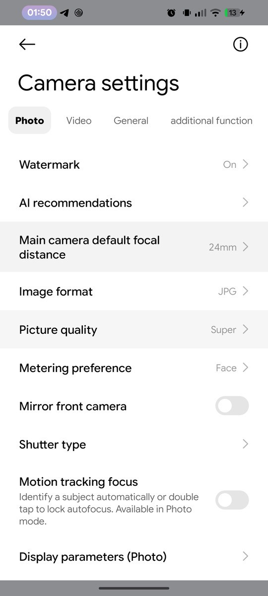
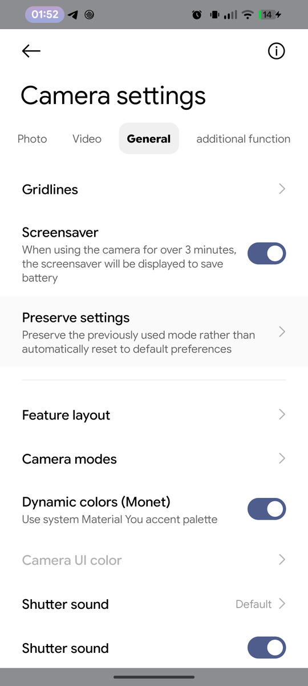
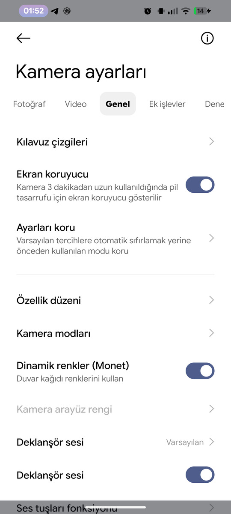
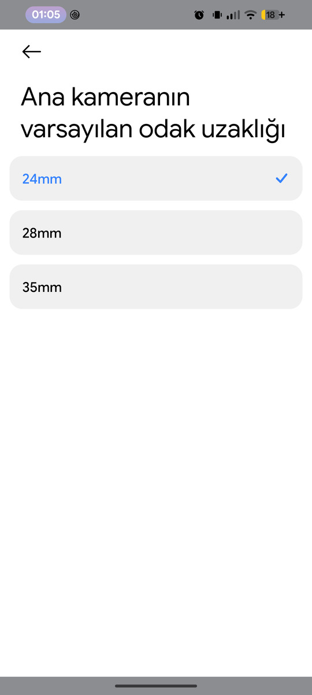
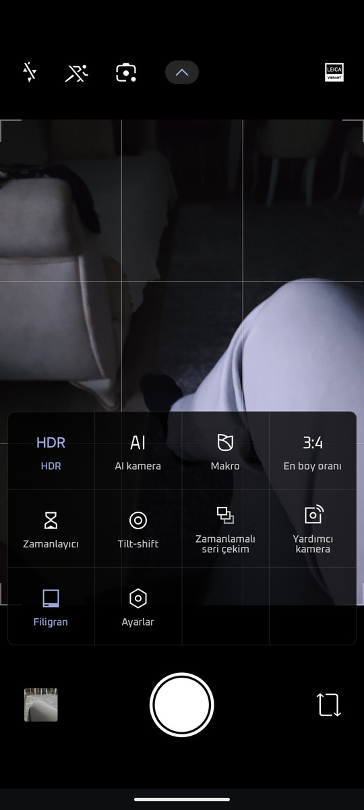
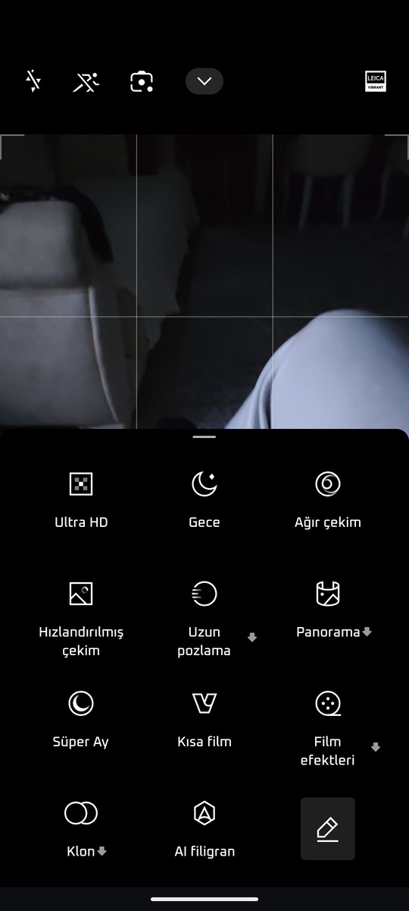

# HyperOS Leica Camera for Xiaomi 12 Pro (zeus)

**[English](#english) · [Türkçe](#türkçe)**

HyperOS Camera 6.2 with Leica looks, patched to work on **AOSP-based Android 17 ROMs** for the **Xiaomi 12 Pro (zeus)**, packaged as a root module.

by **Ahmet033**

---

## English

### Features

| Feature | Status |
|---|---|
| Leica Authentic style (Photo, Pro) and Leica Portrait style, processed on the GPU | ✅ (new in v1.1) |
| Leica Vibrant and Leica filters (VIV / NAT / BW) | ✅ |
| Leica watermark with focal length, aperture, shutter speed and ISO (rear cameras) | ✅ (new in v1.1) |
| Photo and video (picture + sound) | ✅ |
| 0.6x ultra-wide (photo and video) | ✅ |
| 2x / 5x telephoto switching | ✅ |
| Up to 60x zoom | ✅ |
| 1080p 60 FPS video | ✅ |
| Portrait (bokeh), front and rear | ✅ |
| Beautify (Smooth / Slender / Big eyes) | ✅ * |
| Ultra HD (50 MP), bright and low light | ✅ (fixed in v1.2) |
| Video bokeh: rear 720p30, front 1080p30 | ✅ (rear fixed in v1.2) |
| Monet (wallpaper) colors, off by default | ✅ (new in v1.3) |
| Turkish and English (Chinese as in the original) | ✅ (new in v1.3) |
| Pro mode | ✅ |

\* The beautify effect is subtle in the live preview but is fully applied to the captured photo.

### Screenshots

|  |  |  |  |
| --- | --- | --- | --- |
| Settings (English) | Monet switch | Turkish UI | 24 / 28 / 35 mm |
|  |  |
| Quick menu | More modes |

### What's new in v1.4

- The zoom bubble and the photo info now show the same focal length (0.6x 16 mm, 3.2x 77 mm, 5x 120 mm, 10x 240 mm, 20x 480 mm). Reported by MICKY.

**Known issues:** video filters are not applied (the HAL ignores the filter ids of this camera version); front video beauty, Ultra HD at 0.6x; at 0.8x the bubble shows 21 mm instead of 19 mm.

### What's new in v1.3

- **Focal lengths are no longer 0 mm.** The zeus HAL does not report them, so the 1x button showed "0 mm" and the default focal length list started with 0mm. The lens value is used instead (14 / 24 / 47 mm, front 25). The list is now 24 / 28 / 35 mm. The 1x button shows 29 / 36 mm instead of 28 / 35, because the app rounds the zoom to 1.2x / 1.5x.
- **Dynamic colors (Monet)** switch in Settings > General, made by Joshaby. Off by default here, so the Leica red stays.
- **Turkish.** The camera follows the phone language: Turkish on Turkish phones, otherwise English (Chinese stays). About 1600 strings are Xiaomi's own Turkish from older cameras, the rest was translated for this module. A few names and formatted texts stay English.

### What's new in v1.2

- **Ultra HD photos are no longer green and tiled in low light.** This was our own bug: the v1.0 / v1.1 portrait fix always used the 8192x6144 stream, also when the HAL delivers a 4096x3072 (binned) frame. Sorry about that. Portrait still works.
- **Rear video bokeh no longer crashes the camera service.** The HAL node only has room for 1280x720, but the app raised the quality to 1080p30. Rear bokeh now records at 720p30; front bokeh keeps 1080p30.
- **Fastshot was removed** (mode and settings entry). The mode cannot open the camera, and the entry crashed the app because it opens a HyperOS-only Settings page.

### What's new in v1.1

- **Leica Authentic is now really applied.** In v1.0 the Authentic button was there, but on zeus the style had no effect: Authentic and Vibrant photos of the same scene measured the same. Sorry about that. The camera now uses its own GPU Leica renderer (color table + vignette) in Photo, Pro and Portrait (Leica Portrait).
- **The watermark is no longer missing the exposure line.** The zeus HAL does not report a 35 mm focal length, so the whole line stayed empty. It is now calculated from the lens and the zoom: 0.6x = 16 mm, 1x = 24 mm, 2x = 48 mm, 5x = 120 mm, 60x = 1440 mm. The same value is written to EXIF when the watermark is on.
- The installer stops on ROMs that already have this camera built in (`system/priv-app/LeicaMiuiCamera`).

### Tested on

- Xiaomi 12 Pro (zeus)
- Evolution X 12.4, Android 17 (vendor OS3.0.4.0.VLBMIXM)
- BakaSU (KernelSU based) root, SELinux enforcing

Magisk and APatch were **not** tested. Other AOSP-based Android 17 ROMs with the same zeus vendor should work but were not tested.

### Install

1. If you have the Xiaomi 12 (cupid) Leica module (`cupid-miuicamera`) installed, **remove it first** and reboot.
2. Download `zeus-hyperos-leica-camera-aosp-v1.4.zip` from [Releases](../../releases).
3. Install it from your root manager (KernelSU / BakaSU).
4. Reboot.

The installer clears Android's package cache automatically, which is needed for the system to pick up the new camera. The first launch resets the camera app's own settings once (the app signature changes). Photos and videos are not affected.

### Uninstall

Remove the module from your root manager and reboot. The package cache is cleared automatically, and the ROM's own camera comes back.

### Known limitations

- The beautify effect is subtle in the live preview but is fully applied to the captured photo.
- The camera app puts the watermark on rear camera photos only.
- Leica Authentic has separate color tables for food, people, night, plants and sunrise / sunset. Only the general and plants tables were seen working in tests; the others were not triggered.
- The module zip of v1.4 was not flashed as is: its camera code was tested on zeus with the camera built into the ROM, and its install and mount scripts are the same as v1.3.
- Not tested yet: Night, Slow motion, Time-lapse, Long exposure, Panorama, Supermoon, Short film, Movie effects, Clone, AI watermark.
- Made for HyperOS Camera `1+6.2.000360.1` only; the patches use fixed offsets.

### What was wrong and how it was fixed

The HyperOS camera expects a HyperOS ROM. On AOSP it ran with several features silently disabled:

1. **Missing HyperOS framework classes** (`AudioParaManger`, `MiuiSettings`, `HapticFeedbackUtil`, ...): video mode froze. Small stub classes were added (`patcher/stubs`).
2. **Vendor tags were never discovered.** On non-HyperOS ROMs the camera only reads `getAvailableCaptureRequestKeys()` instead of all vendor keys, so bokeh, 1080p 60 FPS, beautify ratios, smooth lens transition, MFNR and more were never sent to the camera HAL. The camera now always uses `getAllVendorKeys()`.
3. **Zoom used crop regions instead of `zoomRatio`.** With crop regions you cannot go below 1x (the crop becomes negative and the framework turns it into 1.0), so 0.6x stayed on the main lens. The camera now sends `CONTROL_ZOOM_RATIO` directly, and the zeus zoom list starts at 0.65x, the HAL's minimum.
4. **Wrong beautify type.** The old "3D beauty" tab type is not supported by this camera version on zeus; type `11` (Smooth / Slender / Big eyes) is used instead, and the beautify ratios are sent without the vendor tag check.
5. **Portrait capture hung.** The portrait still-capture path asked for an output stream that the portrait session on zeus does not have, so the capture failed and timed out after 10 seconds. It now uses the existing stream when there is no binning stream (v1.2; v1.0 / v1.1 always used it, which broke Ultra HD).
6. **Leica style never reached the photo.** The zeus HAL has no `com.xiaomi.sessionparams.stylizationType` tag and the app's own GPU style renderer was enabled only for another device. It is now enabled (two one-instruction patches found by Joshaby for the Xiaomi 12).
7. **Empty watermark line.** Without `com.xiaomi.sensor.info.focalLength35mm` the app cleared aperture, shutter speed and ISO as well. `w5.G.c()` now falls back to the lens' 35 mm equivalent multiplied by the zoom ratio ([`patcher/focal35.smali`](patcher/focal35.smali)).

**Up to 60x zoom:** the camera HAL limits digital zoom with `maxDigitalZoom` / `extendedMaxZoomRatio` in `/vendor/etc/camera/camxoverridesettings.txt`. On every boot the module copies the ROM's own file, changes only these two values to 60 and bind-mounts it over the original. Nothing on the vendor partition is changed, and the other camera files stay as they are.

All patches are listed with offsets, original bytes and reasons in [`patcher/patch.py`](patcher/patch.py).

### Build it yourself

You need the original APK `Camera 1+6.2.000360.1 com.android.camera.apk` (sha256 `662c76d61f2fbe5fb9c66454ffa7a0b42fcb1b05849657ba3f1f50649415bed3`), Python 3, Java, `zipalign`, `apksigner`, `zip` and smali / baksmali 2.3.x.

```
python3 patcher/patch.py --apk "Camera 1+6.2.000360.1 com.android.camera.apk" \
    --smali smali.jar --baksmali baksmali.jar
```

The module zip is written to `out/`. Without `--key` / `--cert` a throwaway signing key is generated.

### Credits

Thanks to everyone whose work made this possible:

- **Joshabys & joaovti**: the Xiaomi 12 (cupid) MIUI / Leica camera module ([xiaomi-12-MIUI-Leica-Camera-Module](https://github.com/joaovti/xiaomi-12-MIUI-Leica-Camera-Module)). This module's skeleton, install and mount scripts and camera libraries are based on it.
- **Joshaby**: the GPU Leica style patches and the cause of the empty watermark line ([miuicamera-cupid, patches-6.2](https://github.com/Joshabys-Xiaomi-12-Org/android_device_xiaomi_miuicamera-cupid/tree/lineage-24.0-6.6/patches-6.2)). The Monet switch (v1.3).
- **MICKY** (Xiaomi 12 Pro | Port Support): reported the Fastshot and video bokeh crashes and pointed to the code behind both. Reported the 0 mm focal length (v1.3) and the bubble/photo mismatch (v1.4).
- **Dmitry Chusovitin**: reported the green Ultra HD photos.
- **backslashxx**: [mountify](https://github.com/backslashxx/mountify), the base of the OverlayFS mount logic.
- **EnOt15P (4pda: EnOt.P)**: TurboOS for Xiaomi 12 Pro, used to study the HyperOS camera on zeus.
- **KyoKusanaghi**: the zeus MIUI camera device / vendor repositories, used as the working reference for comparison.
- **Zeus Lover ⚡ (@Uzumakii_naarutoo)**: for sharing the HyperOS Camera 6.2 APK in KyoKusanaghi's Telegram group.
- **TonyC**: the "Mi 12 Pro 60x zoom enable" module, which showed the camx settings behind 60x zoom.
- **JesusFreke**: smali / baksmali.
- **Xiaomi**: HyperOS Camera.

### Disclaimer

HyperOS Camera and the included camera libraries are the property of Xiaomi. This project is not affiliated with Xiaomi. Use at your own risk.

---

## Türkçe

### Özellikler

| Özellik | Durum |
|---|---|
| Leica Authentic stili (Fotoğraf, Pro) ve Leica Portrait stili, GPU üzerinde | ✅ (v1.1 ile yeni) |
| Leica Vibrant ve Leica filtreleri (VIV / NAT / BW) | ✅ |
| Odak uzaklığı, diyafram, süre ve ISO yazan Leica filigranı (arka kameralar) | ✅ (v1.1 ile yeni) |
| Fotoğraf ve video (görüntü + ses) | ✅ |
| 0.6x geniş açı (fotoğraf ve video) | ✅ |
| 2x / 5x tele geçişleri | ✅ |
| 60x'e kadar yakınlaştırma | ✅ |
| 1080p 60 FPS video | ✅ |
| Portre (bokeh), ön ve arka kamera | ✅ |
| Güzelleştirme (Smooth / Slender / Big eyes) | ✅ * |
| Ultra HD (50 MP), bol ve az ışıkta | ✅ (v1.2'de düzeldi) |
| Video bokeh: arka 720p30, ön 1080p30 | ✅ (arka v1.2'de düzeldi) |
| Monet (duvar kâğıdı) renkleri, varsayılan kapalı | ✅ (v1.3'te yeni) |
| Türkçe ve İngilizce (Çince orijinaldeki gibi) | ✅ (v1.3'te yeni) |
| Pro mod | ✅ |

\* Güzelleştirme etkisi önizlemede hafif görünür, çekilen fotoğrafa ise tam olarak uygulanır.

### Ekran görüntüleri

|  |  |  |  |
| --- | --- | --- | --- |
| Ayarlar (İngilizce) | Monet anahtarı | Türkçe arayüz | 24 / 28 / 35 mm |
|  |  |
| Hızlı menü | Diğer modlar |

### v1.4'te yeni

- Yakınlaştırma balonu ile fotoğraf bilgisi artık aynı odak uzaklığını gösteriyor (0.6x 16 mm, 3.2x 77 mm, 5x 120 mm, 10x 240 mm, 20x 480 mm). MICKY bildirdi.

**Bilinen sorunlar:** video filtreleri uygulanmıyor (kamera katmanı bu sürümün filtre numaralarını tanımıyor); ön video güzelleştirme, Ultra HD 0.6x; 0.8x'te balon 19 yerine 21 mm gösteriyor.

### v1.3'te yeni

- **Odak uzaklığı artık 0 mm görünmüyor.** zeus'un kamera katmanı bunu bildirmiyor; 1x düğmesinde "0 mm", varsayılan odak listesinde 0mm çıkıyordu. Artık lensin değeri kullanılıyor (14 / 24 / 47 mm, ön 25). Liste 24 / 28 / 35 mm oldu. Uygulama yakınlaştırmayı 1.2x / 1.5x'e yuvarladığı için 1x düğmesi 28 / 35 yerine 29 / 36 mm gösteriyor.
- Ayarlar > Genel'de Joshaby'nin **Dinamik renkler (Monet)** anahtarı. Burada varsayılan kapalı, yani Leica kırmızısı duruyor.
- **Türkçe.** Kamera telefonun dilini izler: Türkçe telefonda Türkçe, diğerlerinde İngilizce (Çince duruyor). Yaklaşık 1600 metin Xiaomi'nin eski kameralarındaki resmî Türkçe, kalanı bu modül için çevrildi. Bazı adlar ve biçimli metinler İngilizce kaldı.

### v1.2'de yeni

- **Ultra HD fotoğraflar az ışıkta artık yeşil ve döşenmiş çıkmıyor.** Hata bizdendi: v1.0 / v1.1'deki portre düzeltmesi, kamera katmanı 4096x3072 (birleştirilmiş) kare verdiğinde de hep 8192x6144 akışını kullanıyordu. Bunun için özür dilerim. Portre çalışmaya devam ediyor.
- **Arka video bokeh artık kamera servisini çökertmiyor.** Kamera katmanındaki parçada yalnız 1280x720'lik yer var, uygulama ise kaliteyi 1080p30'a yükseltiyordu. Arka bokeh artık 720p30 kaydediyor; ön bokeh 1080p30'da kalıyor.
- **Fastshot kaldırıldı** (mod ve ayar satırı). Mod kamerayı açamıyor, ayar satırı da yalnız HyperOS'ta olan bir Ayarlar sayfasını açtığı için uygulamayı çökertiyordu.

### v1.1'de yeni

- **Leica Authentic artık gerçekten uygulanıyor.** v1.0'da Authentic düğmesi vardı ama zeus'ta stilin etkisi yoktu: aynı sahnenin Authentic ve Vibrant kareleri ölçümde aynı çıkıyordu. Bunun için özür dilerim. Kamera artık Fotoğraf, Pro ve Portre'de (Leica Portrait) kendi GPU Leica işlemesini (renk tablosu + köşe karartma) kullanıyor.
- **Filigranda çekim bilgisi satırı artık boş kalmıyor.** zeus'un kamera katmanı 35 mm odak uzaklığını bildirmediği için bütün satır boş kalıyordu. Değer artık lense ve yakınlaştırmaya göre hesaplanıyor: 0.6x = 16 mm, 1x = 24 mm, 2x = 48 mm, 5x = 120 mm, 60x = 1440 mm. Filigran açıkken aynı değer EXIF'e de yazılıyor.
- Bu kamerayı zaten içeren ROM'larda (`system/priv-app/LeicaMiuiCamera`) kurulum durur.

### Test edildiği ortam

- Xiaomi 12 Pro (zeus)
- Evolution X 12.4, Android 17 (vendor OS3.0.4.0.VLBMIXM)
- BakaSU (KernelSU tabanlı) root, SELinux Enforcing

Magisk ve APatch ile **denenmedi**. Aynı zeus vendor'ını kullanan diğer AOSP tabanlı Android 17 ROM'larda çalışması beklenir ama denenmedi.

### Kurulum

1. Xiaomi 12 (cupid) Leica modülü (`cupid-miuicamera`) kuruluysa **önce onu kaldırıp** yeniden başlat.
2. [Releases](../../releases) bölümünden `zeus-hyperos-leica-camera-aosp-v1.4.zip` dosyasını indir.
3. Root yöneticinden (KernelSU / BakaSU) kur.
4. Telefonu yeniden başlat.

Kurulum, sistemin yeni kamerayı görebilmesi için gereken Android paket önbelleği temizliğini kendisi yapar. İlk açılışta kamera uygulamasının kendi ayarları bir kez sıfırlanır (uygulama imzası değiştiği için). Fotoğraf ve videolarına dokunulmaz.

### Kaldırma

Modülü root yöneticisinden kaldır ve yeniden başlat. Paket önbelleği kendiliğinden temizlenir, ROM'un kendi kamerası geri gelir.

### Bilinen sınırlar

- Güzelleştirme etkisi önizlemede hafif görünür, çekilen fotoğrafa ise tam olarak uygulanır.
- Kamera uygulaması filigranı yalnız arka kamera fotoğraflarına ekliyor.
- Leica Authentic'in yemek, insan, gece, bitki ve gün doğumu / batımı için ayrı renk tabloları var. Testlerde yalnız genel ve bitki tablolarının çalıştığı görüldü, diğerleri tetiklenmedi.
- v1.4 modül zip'i olduğu hâliyle kurulup denenmedi: kamera kodu zeus'ta, kamerası ROM'a gömülü sistemde denendi; kurulum ve bağlama betikleri v1.3 ile aynı.
- Henüz denenmeyenler: Night, Slow motion, Time-lapse, Long exposure, Panorama, Supermoon, Short film, Movie effects, Clone, AI watermark.
- Sadece HyperOS Kamera `1+6.2.000360.1` için yapıldı; yamalar sabit konumlara uygulanır.

### Sorun neydi, nasıl düzeldi

HyperOS kamerası bir HyperOS ROM'u bekliyor. AOSP'de birçok özelliği sessizce kapalı çalışıyordu:

1. **Eksik HyperOS çerçeve sınıfları** (`AudioParaManger`, `MiuiSettings`, `HapticFeedbackUtil`…): video modu donuyordu. Küçük taklit sınıflar eklendi (`patcher/stubs`).
2. **Xiaomi etiketleri hiç sorgulanmıyordu.** HyperOS olmayan ROM'larda kamera bütün vendor etiketleri yerine sadece `getAvailableCaptureRequestKeys()` listesine bakıyor. Bu yüzden bokeh, 1080p 60 FPS, güzelleştirme oranları, yumuşak lens geçişi, MFNR ve daha fazlası kamera katmanına hiç gönderilmiyordu. Kamera artık her zaman `getAllVendorKeys()` kullanıyor.
3. **Yakınlaştırma `zoomRatio` yerine kırpma alanıyla yapılıyordu.** Kırpmayla 1x'in altına inilemiyor: kırpma alanı negatif oluyor, Android de bunu 1.0'a çeviriyor. 0.6x bu yüzden ana lenste kalıyordu. Kamera artık doğrudan `CONTROL_ZOOM_RATIO` gönderiyor, zeus yakınlaştırma listesi de kamera katmanının alt sınırı olan 0.65x'ten başlıyor.
4. **Yanlış güzelleştirme türü.** Eski "3D güzelleştirme" türü bu kamera sürümünde zeus için desteklenmiyor. Yerine tür `11` (Smooth / Slender / Big eyes) kullanılıyor, güzelleştirme oranları da etiket kontrolü olmadan gönderiliyor.
5. **Portre çekimi donuyordu.** Portre fotoğraf çekimi, zeus'taki portre oturumunda bulunmayan bir akışı istiyordu. Çekim başarısız olup 10 saniye sonra zaman aşımına uğruyordu. Artık birleştirme akışı yoksa var olan akışı kullanıyor (v1.2; v1.0 / v1.1 hep onu kullanıyordu ve Ultra HD'yi bozuyordu).
6. **Leica stili fotoğrafa hiç ulaşmıyordu.** zeus'un kamera katmanında `com.xiaomi.sessionparams.stylizationType` etiketi yok, uygulamanın kendi GPU stil işlemesi de yalnız başka bir cihaz için açıktı. Artık açık (Joshaby'nin Xiaomi 12 için bulduğu iki tek komutluk yama).
7. **Boş filigran satırı.** `com.xiaomi.sensor.info.focalLength35mm` olmayınca uygulama diyaframı, süreyi ve ISO'yu da siliyordu. `w5.G.c()` artık lensin 35 mm karşılığını yakınlaştırmayla çarpıyor ([`patcher/focal35.smali`](patcher/focal35.smali)).

**60x'e kadar yakınlaştırma:** Kamera katmanı dijital yakınlaştırmayı `/vendor/etc/camera/camxoverridesettings.txt` içindeki `maxDigitalZoom` / `extendedMaxZoomRatio` ile sınırlıyor. Modül her açılışta ROM'un kendi dosyasını kopyalıyor, sadece bu iki değeri 60 yapıyor ve orijinalin üstüne bağlıyor. Vendor bölümünde hiçbir şey değişmiyor, diğer kamera dosyaları olduğu gibi kalıyor.

Bütün yamalar konumları, orijinal baytları ve gerekçeleriyle [`patcher/patch.py`](patcher/patch.py) içinde.

### Kendin derle

Orijinal APK `Camera 1+6.2.000360.1 com.android.camera.apk` (sha256 `662c76d61f2fbe5fb9c66454ffa7a0b42fcb1b05849657ba3f1f50649415bed3`), Python 3, Java, `zipalign`, `apksigner`, `zip` ve smali / baksmali 2.3.x gerekir.

```
python3 patcher/patch.py --apk "Camera 1+6.2.000360.1 com.android.camera.apk" \
    --smali smali.jar --baksmali baksmali.jar
```

Modül zip'i `out/` klasörüne yazılır. `--key` / `--cert` verilmezse geçici bir imza anahtarı üretilir.

### Teşekkürler

Bu çalışmayı mümkün kılan herkese teşekkürler:

- **Joshabys & joaovti**: Xiaomi 12 (cupid) MIUI / Leica kamera modülü ([xiaomi-12-MIUI-Leica-Camera-Module](https://github.com/joaovti/xiaomi-12-MIUI-Leica-Camera-Module)). Bu modülün iskeleti, kurulum ve bağlama betikleri ve kamera kütüphaneleri ona dayanıyor.
- **Joshaby**: GPU Leica stili yamaları ve boş filigran satırının nedeni ([miuicamera-cupid, patches-6.2](https://github.com/Joshabys-Xiaomi-12-Org/android_device_xiaomi_miuicamera-cupid/tree/lineage-24.0-6.6/patches-6.2)). Monet anahtarı (v1.3).
- **MICKY** (Xiaomi 12 Pro | Port Support): Fastshot ve video bokeh çökmelerini bildirdi, ikisinin de kodunu gösterdi. 0 mm odak hatasını (v1.3) ve balon/fotoğraf farkını (v1.4) bildirdi.
- **Dmitry Chusovitin**: yeşil Ultra HD fotoğraflarını bildirdi.
- **backslashxx**: [mountify](https://github.com/backslashxx/mountify), OverlayFS bağlama mantığının temeli.
- **EnOt15P (4pda: EnOt.P)**: Xiaomi 12 Pro için TurboOS; zeus'ta HyperOS kamerasını incelemek için kullanıldı.
- **KyoKusanaghi**: zeus MIUI kamera device / vendor depoları; karşılaştırma için çalışan referans olarak kullanıldı.
- **Zeus Lover ⚡ (@Uzumakii_naarutoo)**: HyperOS Kamera 6.2 APK'sını KyoKusanaghi'nin Telegram grubunda paylaştığı için.
- **TonyC**: 60x yakınlaştırmanın arkasındaki camx ayarlarını gösteren "Mi 12 Pro 60x zoom enable" modülü.
- **JesusFreke**: smali / baksmali.
- **Xiaomi**: HyperOS Kamera.

### Uyarı

HyperOS Kamera ve modüldeki kamera kütüphaneleri Xiaomi'nin malıdır. Bu proje Xiaomi ile bağlantılı değildir. Kullanım sorumluluğu kullanıcıya aittir.
